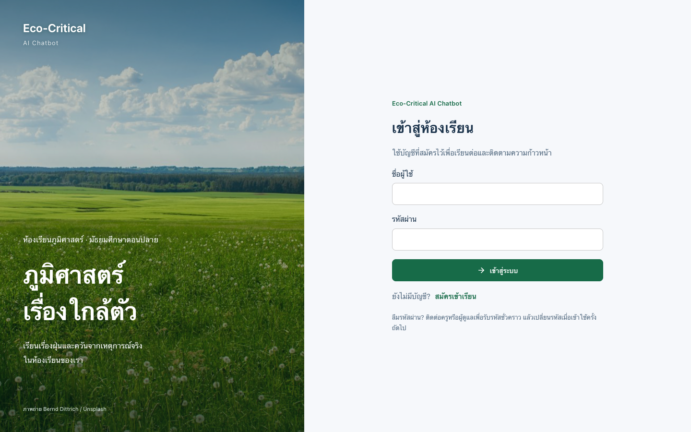

# Eco-Critical AI Chatbot

ห้องเรียนภูมิศาสตร์สำหรับนักเรียน ม.ปลาย: กรณีศึกษาฝุ่นและควันพิษจากหลายประเทศ บทเรียนสิ่งแวดล้อม ผู้ช่วยตอบจากเอกสารครู และบอร์ดสนทนาร่วมกัน

React/Vite ใน repository เดิม ใช้ **ซอร์ส Mentingo จริง** สำหรับหน้าบทเรียน แค็ตตาล็อก และองค์ประกอบหน้าครู พร้อม backend บัญชีและข้อมูลบน Cloudflare Pages + D1. เก็บซอร์ส AnythingLLM/collector เดิมไว้เป็นอีกเส้นทางหนึ่ง ดู [ที่มาและใบอนุญาต](third_party/mentingo/README.md).

**สถานะรุ่นนี้:** ระบบบัญชีจริงผ่านการทดสอบกับ Worker/D1 ภายในเครื่องแล้ว การเผยแพร่รุ่นบัญชีจริงที่ `eco-critical.pages.dev` ยังรออนุญาตบันทึก secrets บน Cloudflare; อย่าใช้ public deployment รุ่นก่อนหน้าเป็นหลักฐานว่ารุ่นนี้ขึ้นระบบแล้ว ดู [สถานะเผยแพร่](docs/DEPLOYMENT.md).



## เริ่มพัฒนา

ใช้ Node.js 24 และ npm:

```bash
npm --prefix frontend ci --legacy-peer-deps
npm --prefix frontend run dev
```

เปิด [127.0.0.1:3410](http://127.0.0.1:3410). คำสั่งเดียวเริ่ม React, API และ D1 **ภายในเครื่อง** พร้อม migrations. ข้อมูล local อยู่ใน `.classroom-local/worker-state/`; คำสั่งนี้ไม่เขียนฐานข้อมูล Cloudflare จริง.

ข้อมูลตั้งค่าบัญชีเจ้าของอยู่ใน `.classroom-local/admin-setup.txt` ซึ่งเป็นไฟล์ส่วนตัว ไม่ส่งขึ้น Git. บัญชีตั้งต้นต้องใช้รหัสตั้งค่าเจ้าของและเปลี่ยนรหัสผ่านก่อนใช้หน้าจัดการ. สคริปต์รักษา secrets เดิมไว้ ไม่สร้างทับทุกครั้ง.

## การใช้งาน

- สมัครบัญชี → รอครูหรือแอดมินอนุมัติ → เข้าห้องเรียนเดียวกัน. ไม่มีสวิตช์เปลี่ยนบทบาทสาธารณะ.
- อ่าน 6 กรณีศึกษาประวัติศาสตร์–ปัจจุบันและ 4 บทเรียนพื้นฐาน ทำกิจกรรม/แบบทดสอบ และดูความก้าวหน้าที่ผูกบัญชี.
- ครูแก้เนื้อหาและแบบทดสอบ อัปโหลด TXT/Markdown อ่านเอกสารจริง และตรวจรายชื่อนักเรียนกับผลเรียน.
- แอดมินมอบสิทธิ์ครู/แอดมิน ระงับบัญชี และรีเซ็ตรหัสผ่าน. การเปลี่ยนสิทธิ์ยกเลิกเซสชันเดิม.
- สมาชิกที่อนุมัติแล้วตั้งกระทู้/ตอบร่วมกัน เจ้าของลบข้อความตนเองได้ ครูและแอดมินดูแลข้อความได้.
- ตั้ง Gemini key จากหน้า **ตั้งค่า AI** ของแอดมิน. Key เข้ารหัสฝั่งเซิร์ฟเวอร์และไม่ส่งกลับ React. คำตอบอิงข้อความที่ค้นจากเอกสาร/เนื้อหาครู พร้อมแหล่งอ้างอิง. ไม่อ้างว่าใช้ vector embeddings.

รายละเอียด workflow และข้อจำกัด: [FEATURES](docs/FEATURES.md).

## Build และตรวจสอบ

```bash
npm --prefix frontend run lint:classroom
node --test tests/classroom/*.test.mjs
npm --prefix frontend run build:school
node scripts/run-classroom-qa.mjs
```

`build:school` สร้าง `frontend/dist-demo/` (ชื่อไดเรกทอรีเดิม) พร้อม `_worker.js` สำหรับ Pages; ชื่อ artifact ไม่ได้หมายความว่าเป็นบัญชีสาธิต. `npm --prefix frontend run build` ยังคงสร้าง artifact สำหรับ upstream Express แยกต่างหาก.

Browser QA ใช้ compiled app, local D1 ใหม่, secrets/บัญชีทดสอบแยก และ Chrome โดยไม่มี API interception. ไม่แตะข้อมูล production และไม่เรียก Gemini จริง. สำหรับ CI ติดตั้ง Chromium แล้วใช้ `CLASSROOM_QA_BROWSER=chromium`. รายงานใน `artifacts/classroom/`; [หลักฐานและขอบเขตการตรวจ](docs/VALIDATION.md), [GitHub Actions](docs/CI.md).

## ข้อจำกัดที่ต้องทราบ

- ยังไม่ได้รับ Gemini key จึงยังไม่ยืนยันการเรียกโมเดลจริงหรือความถูกต้องของคำตอบ.
- Cloudflare รุ่นนี้รองรับ TXT/Markdown ไม่เกิน 1 MB/ไฟล์ และข้อมูลหลักสูตรรวม 1.8 MB. PDF/DOCX/OCR ของ collector เดิมไม่ได้ถูก deploy บน Pages.
- ไม่มี SMTP/กู้รหัสผ่านอีเมลอัตโนมัติ; ใช้แอดมินออกรหัสชั่วคราวและบังคับเปลี่ยนรหัส.
- รองรับหนึ่งห้องเรียน ไม่อ้างว่าแยกข้อมูลหลายโรงเรียน.
- ไม่ได้ทดสอบ Docker runtime หรืออุปกรณ์ iOS/Android จริง. เก็บ `compose.classroom.yaml` และ `scripts/setup-classroom.mjs` สำหรับ backend เดิมไว้โดยไม่อ้างว่า Cloudflare ใช้งานส่วนนั้น.
- ต้องสำรอง APP_SECRET อย่างปลอดภัย; ใช้ทั้ง password pepper และถอดรหัส Gemini key ห้ามสร้างทับโดยไม่มีแผนย้ายข้อมูล.
