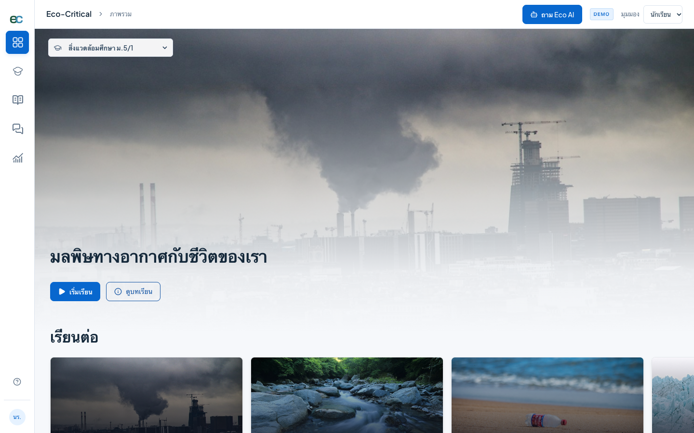

# Eco-Critical AI Chatbot

Thai-first environmental EdTech for ม.4–ม.6 and teachers. **React/Vite**, adapted in the same codebase from [AnythingLLM](https://github.com/Mintplex-Labs/anything-llm), MIT. The student catalog and lesson pages directly render original MIT [Mentingo](https://github.com/Selleo/mentingo) frontend components, with native teacher tables/forms, Eco-Critical branding, real environmental course photographs and source inspection. [Source attribution](third_party/mentingo/README.md).

**Public demo:** [https://eco-critical-ai-chatbot.demo-agent-jum.workers.dev/demo](https://eco-critical-ai-chatbot.demo-agent-jum.workers.dev/demo) — browser-local teacher/student preview; no live Gemini calls.



## Run the client demo

Node.js 24 and npm are sufficient. No Gemini key or backend is required for the explicitly labeled demo.

```bash
cd frontend
npm ci --legacy-peer-deps
npm run dev
```

Open [localhost:3000/demo](http://localhost:3000/demo). The root route also opens the demo. Switch **มุมมอง → คุณครู** to demonstrate teacher tools. Demo changes are saved in this browser; they are not shared with other users.

### Production demo artifact

```bash
cd frontend
npm run build:demo
npm run preview:demo
```

Open [localhost:3415/demo](http://localhost:3415/demo). `frontend/dist-demo/` is a static production artifact from the same application. Use an SPA fallback when hosting it. The separate `npm run build` produces the upstream server artifact with `_index.html`, as AnythingLLM expects.

## Implemented experience

- Mentingo-based student dashboard with four environmental image covers, cool-white surfaces, native social-app typography, genuine per-browser progress, continue learning and access to the working contextual tutor.
- Two sample classrooms and four visual lessons: air pollution, water pollution, plastic waste, climate change. Air and water include full explanations and comprehension checks; plastic includes waste sorting.
- PM2.5 conceptual slider, waste sorting with immediate feedback, quizzes with correct-answer explanations. Values are explicitly illustrative, not live sensor readings or health thresholds.
- Contextual tutor beside lessons on desktop; an explicit tutor view on narrow screens. Source references open the actual retrieved passage and section. No fabricated page numbers.
- Distinct teacher navigation: create/edit classrooms, add/edit lesson title/description/topic, associate uploaded text with a classroom and lesson, inspect/remove/reindex documents, preview as student and inspect demo questions.
- Responsive shell, student bottom navigation, Lucide icons, local Thai fonts and visible keyboard focus.

## AI status: demo versus live

**Demo (`/` and `/demo`)** extracts text from actual sample/uploaded TXT or Markdown in the browser, splits it into sections and performs Thai word-matching retrieval. Answers show exact retrieved text with clickable sources. It does **not** call Gemini, generate embeddings, perform semantic search or authenticate users. It is labeled on every chat and in the app shell. Uploaded demo files are limited to 1 MB to fit browser storage. PDF/DOCX are rejected clearly in demo rather than pretending to parse them.

**Live (`/live`)** retains the upstream Express/collector/SQLite/LanceDB RAG backend and streamed chat. It checks backend availability, then uses native authentication and workspace membership. New workspaces default to Query mode and a Thai environmental-education prompt. Teacher uploads support PDF/DOCX/TXT/Markdown up to 20 MB with server validation; document processing chains into real embeddings. API keys remain on the server. The new live adapter supports actual classrooms, document indexing and chat; the visual lesson authoring metadata, quiz progress and teacher question overview are browser-demo features in this release and still require a server data model for production.

No live Gemini accuracy, OCR performance, server deployment or production authorization integration is implied by frontend tests. Review [validation and limits](docs/VALIDATION.md).

## Live setup

Use Docker Engine + **Docker Compose v2** with several GB free for the upstream build:

```bash
node scripts/setup-classroom.mjs
docker compose -f compose.classroom.yaml up --build -d
```

Open [localhost:3001/live](http://localhost:3001/live), complete onboarding, configure Gemini keys for both LLM and embeddings, and enable multi-user mode. Defaults prepared by setup: `gemini-3.8-flash` and `gemini-embedding-001`; choose models available to the account. Keep `.classroom-local/runtime.env` private. It is excluded from Git and Docker build context. Setup preserves existing env files and never prints keys.

The Compose build uses **this customized source**, not a prebuilt upstream image missing the educational UI. It binds only to loopback until accounts and HTTPS are configured. Named volumes hold data; do not use `down -v` if data must be preserved. Browser agents requiring SYS_ADMIN are outside this classroom configuration.

For native Node development, run `node scripts/setup-classroom.mjs`, install upstream dependencies with `corepack yarn setup`, then run `yarn dev:server`, `yarn dev:collector`, `yarn dev:frontend` in separate terminals. Native canvas/ONNX dependencies may require compiler/system libraries. Vite proxies `/api` to port 3001.

### Access and rollout

- Admin: school operator. Manager: trusted teacher. Default: student assigned to a workspace.
- **Upstream managers can access every workspace**. This is not isolated multi-school tenancy. Demo role switching is not authentication.
- Live retrieval is scoped to the authorized workspace; the live adapter does not yet enforce a per-lesson retrieval filter.
- Before production, implement durable lesson/progress models with account-level authorization, test student isolation on the running backend, verify Thai retrieval/OCR with approved teacher documents, set HTTPS, cost controls, retention and backup/restore.

## Checks

```bash
npm --prefix frontend run lint:classroom
node --test tests/classroom/*.test.mjs
npm --prefix frontend run build
npm --prefix frontend run build:demo
node scripts/run-classroom-qa.mjs
```

Browser QA runs a compiled production demo with no API interception and uses installed Chrome by default. For CI: install Chromium with `cd frontend && npx playwright install chromium`, then run `CLASSROOM_QA_BROWSER=chromium node scripts/run-classroom-qa.mjs` from repo root. Results and screenshots are in ignored `artifacts/classroom/`. A ready-to-review GitHub Actions recipe is provided in `docs/classroom-ci.example.yml`. The active GitHub account lacks workflow scope, so active workflow files were not changed; all listed checks were run locally. Enable the recipe only after an owner grants workflow permission.

## Attribution and design

Original MIT `LICENSE` is retained. [Upstream provenance](docs/OPEN_SOURCE.md) · [original README](README.upstream.md) · [client brief](docs/CLIENT_BRIEF.md) · [design decisions](docs/UI_DESIGN.md). Native Mentingo source integration, impeccable, audit, animate and adapt were applied. Current UI uses platform fonts. [UI audit](docs/UI_AUDIT.md).
